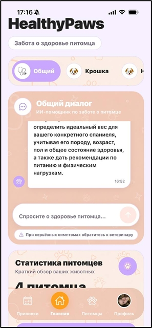
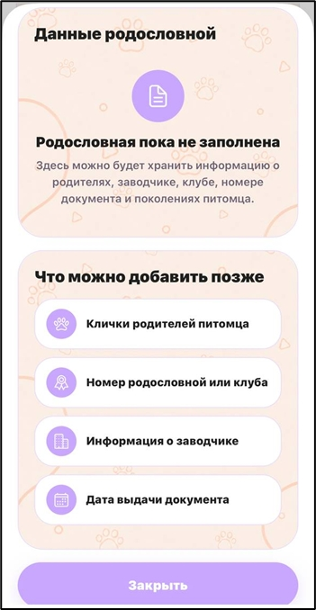

# 🐾 HealthyPaws — Pet Health Management App

**A pet care application for managing pet profiles, health information, and everyday care routines.**

[🌐 Live Demo](https://mypethealthapp.expo.app) · [💻 Source Code](https://github.com/Octrat/MyPetHealthApp)

---

## 📱 Application Preview

Explore the HealthyPaws interface through the screenshots below, or open the live demo to try the application.

<!-- Add your real screenshots to docs/screenshots/ and update these paths. -->

| Home & Pet Profiles | Pet Health & Care |
|:---:|:---:|
|  |  |

| Pet Pedigree | AI Pet Assistant |
|:---:|:---:|
|  |  |

**[Open the Live Demo →](https://mypethealthapp.expo.app)**

---

## ✨ Features

- **Authentication** — user registration and login.
- **Pet Profiles** — manage pet information and breed details.
- **Pedigree Visualization** — explore pet family relationships.
- **Health & Care** — access medication and care-related screens.
- **AI Pet Assistant** — ask pet-related questions using AI-powered functionality.
- **Pet Recognition** — image-related pet recognition features.
- **QR Functionality** — QR-related features for pet identification.
- **Backend API** — communicate with a Node.js and Express server.
- **Database Integration** — store and retrieve application data using PostgreSQL.

*Feature availability may depend on backend configuration, API credentials, and the current implementation.*

## 🛠️ Tech Stack

### Frontend
- React Native
- Expo
- TypeScript
- React Context API

### Backend
- Node.js
- Express
- REST API
- JWT authentication

### Database & External Services
- PostgreSQL
- Google Gemini API for AI-related functionality
- Supabase PostgreSQL, if configured for the selected environment

## 📂 Project Structure

```text
MyPetHealthApp/
├── assets/       # Images, icons, and fonts
├── components/   # UI components and screens
├── src/          # Services, hooks, types, and utilities
├── backend/      # API server, routes, and controllers
├── web/          # Web-related files
├── App.tsx       # Application entry point
└── package.json  # Project scripts and dependencies
```

## 🚀 Live Demo

**[https://mypethealthapp.expo.app](https://mypethealthapp.expo.app)**

The web version can be opened directly in a browser without installing Expo Go.

Some features may require a working backend, authentication, or external service credentials.

## 💻 Getting Started

### Prerequisites

- Node.js and npm
- An Expo-compatible development environment
- PostgreSQL or a configured database connection
- External API credentials for features that require them

### 1. Clone the repository

```bash
git clone https://github.com/Octrat/MyPetHealthApp.git
cd MyPetHealthApp
npm install
```

### 2. Start the frontend

```bash
npx expo start
```

For web development, use the web script configured in `package.json` or run:

```bash
npx expo start --web
```

### 3. Configure the backend

Create `backend/.env` using the project's environment configuration as a reference. Add the required database connection settings, secrets, and API credentials.

Never commit real credentials.

### 4. Start the backend

Open a separate terminal:

```bash
cd backend
npm install
npm run dev
```

Make sure the database is available and the frontend is configured to connect to the correct backend URL.

*Exact setup requirements may vary depending on the environment.*

## 🔐 Security

- Keep `.env` files and private credentials out of version control.
- Never publish database passwords, JWT secrets, or private API keys.
- Use fictional test data in public demos.
- Avoid including personal information in screenshots.

## 📌 Project Status

HealthyPaws is an actively developed project. Features and integrations may evolve as development continues.

## 👩‍💻 Repository

**GitHub:** [Octrat/MyPetHealthApp](https://github.com/Octrat/MyPetHealthApp)

**Live application:** [mypethealthapp.expo.app](https://mypethealthapp.expo.app)
